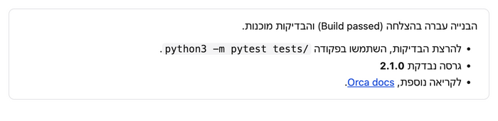

# rtl-render for Orca

A medium-term workaround for reading Hebrew, Arabic, and mixed-language assistant replies in Orca’s native chat while native RTL support is being developed. It uses Orca’s inline visuals and runs locally.

## Install

Requirements: Orca native chat, a locally available Python 3, and `markdown-it-py` installed for the same `python3` that runs in the chat environment. If you use a virtual environment, make that interpreter available to the chat.

1. Install the Markdown parser with `python3 -m pip install markdown-it-py` in that Python environment.
2. Clone this repository or download its ZIP.
3. Copy the repository’s `rtl-render/` folder into your agent’s skills directory. For Codex on macOS and Linux, a user-wide location is `~/.agents/skills/rtl-render/`.
4. Open an Orca native chat and invoke `$rtl-render` on a reply with right-to-left prose, or ask the agent to load the skill for the chat.

## Use

| Command | Behavior |
| --- | --- |
| `$rtl-render` | Show the previous reply in an RTL card. |
| `$rtl-render on` | Stream the reply as a progress message, then show the card. |
| `$rtl-render on keep` | Keep the original reply and the RTL card visible. This is the default when asked to load the skill. |
| `$rtl-render off` | Turn off automatic rendering for the current chat. |

Left-to-right replies stay in the usual chat view. Code stays left-to-right, and local file links are available in the standard chat text. The skill applies to assistant replies inside the chat.
